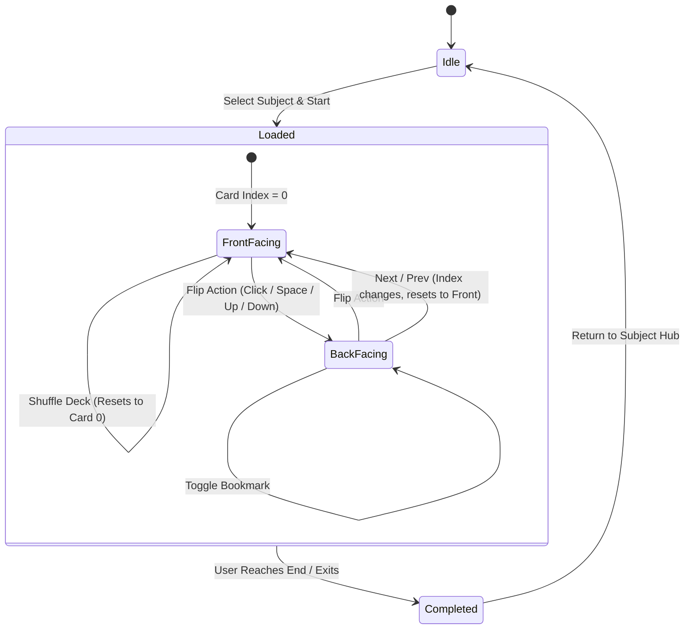
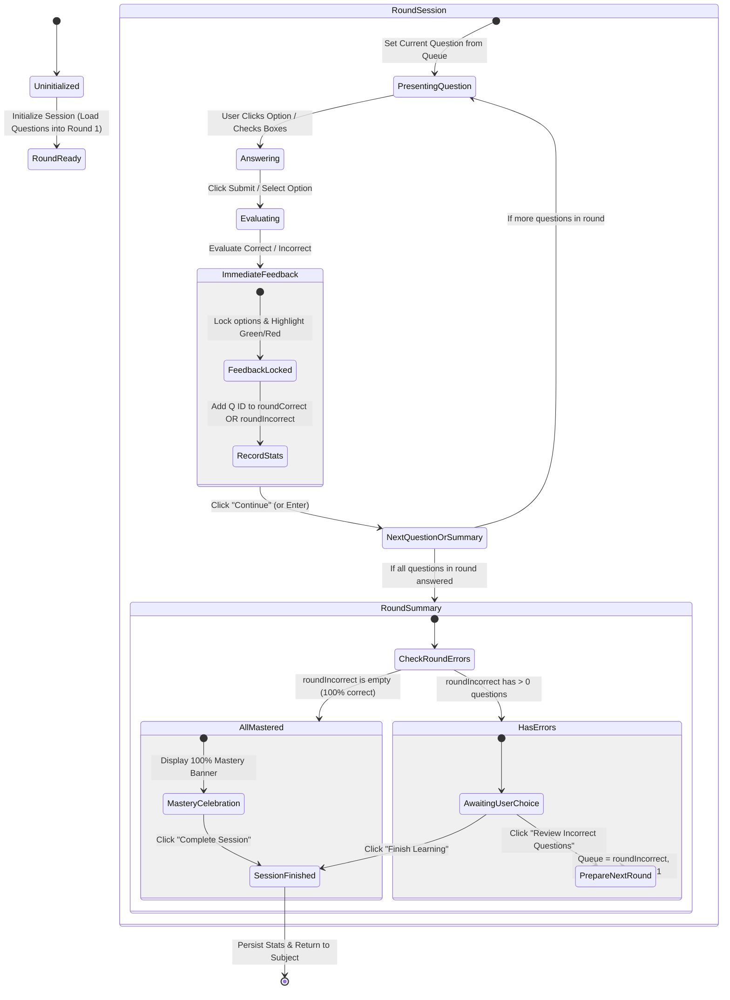
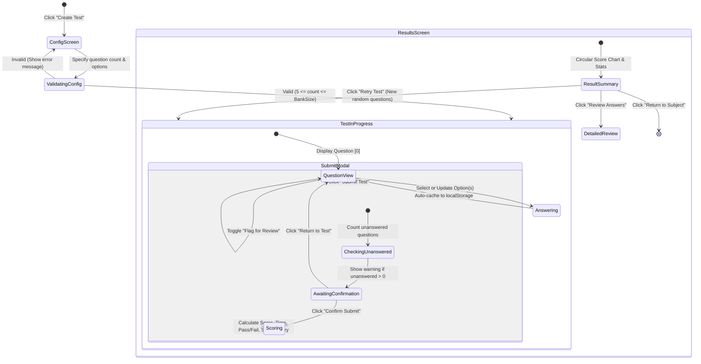

# State Flow & Transition Specifications

This document models the state transitions and lifecycle flows for Recallify's three primary study modes: Flashcards, Adaptive Learning, and Simulated Test.

---

## 1. Flashcards State Flow

---

## 2. Adaptive Learning Engine State Flow

---

## 3. Test Simulation State Flow

