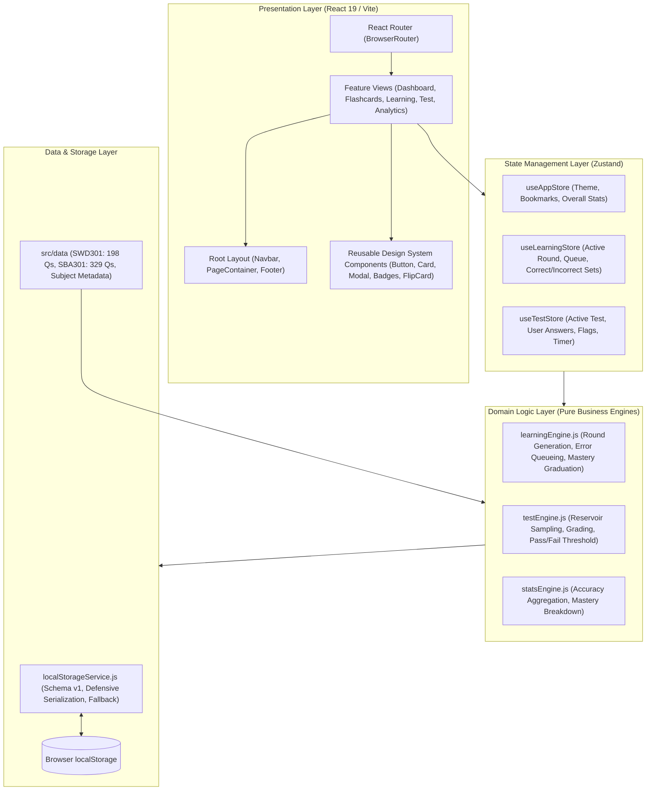

# System Architecture Specification

## 1. Architectural Philosophy & Overview
**Recallify** is engineered as a decoupled, modular, and client-centric Single Page Application (SPA). To ensure commercial-grade reliability without backend overhead, the application cleanly isolates:
1. **Presentation Layer (React Components):** Declarative UI rendering styled with Tailwind CSS and enhanced with Framer Motion transitions.
2. **State Management Layer (Zustand):** Lightweight, reactive, decoupled stores for application state, active learning sessions, and ongoing tests.
3. **Domain Engine Layer (Pure Services):** Framework-agnostic pure JavaScript services handling business logic: question evaluation, repetition queues, test generation, and scoring.
4. **Data Persistence Layer (Storage Service):** Strongly typed, versioned localStorage abstraction with defensive validation and corruption recovery.

---

## 2. Layered Architecture Diagram



---

## 3. Directory Layout Specification

```text
recallify/
├── docs/                       # Project documentation & analysis reports
├── public/                     # Static assets (favicons, logos)
├── scripts/                    # Automation & extraction scripts
├── src/
│   ├── app/
│   │   ├── App.jsx             # Root application component & providers
│   │   └── router.jsx          # Declarative Route definitions
│   │
│   ├── components/             # Reusable design system components
│   │   ├── common/             # Button, Badge, ProgressBar, Modal, Spinner
│   │   ├── layout/             # Navbar, Footer, PageWrapper, Container
│   │   ├── questions/          # OptionItem, QuestionCard, FlipCard, QuestionGrid
│   │   └── feedback/           # FeedbackBanner, ScoreRadial, EmptyState, ConfirmDialog
│   │
│   ├── features/               # Domain-specific page features
│   │   ├── dashboard/          # DashboardOverview, StatWidget, SubjectCards
│   │   ├── subjects/           # SubjectListPage, SubjectDetailPage, QuestionBankView
│   │   ├── flashcards/         # FlashcardsPage, FlashcardViewer, FlashcardDeckSummary
│   │   ├── learning/           # LearningPage, LearningActiveRound, LearningRoundSummary
│   │   ├── tests/              # TestConfigModal, TestRunnerPage, TestResultPage, TestReviewPage
│   │   └── analytics/          # AnalyticsPage, MasteryCharts, TestHistoryTable
│   │
│   ├── data/                   # Immutable Question Banks & Subjects
│   │   ├── subjects.js         # Subject definitions (SWD301, SBA301)
│   │   └── questions/          # subject-01.js, subject-02.js, index.js
│   │
│   ├── services/               # Pure business logic engines
│   │   ├── learning/           # learningEngine.js
│   │   ├── testing/            # testEngine.js
│   │   ├── statistics/         # statsEngine.js
│   │   └── storage/            # localStorageService.js
│   │
│   ├── store/                  # Zustand state stores
│   │   ├── useAppStore.js      # Global preferences, bookmarks, stats
│   │   ├── useLearningStore.js # Active learning session & repetition queue
│   │   └── useTestStore.js     # Active test session, answers, review state
│   │
│   ├── utils/                  # Helper utilities (formatters, shuffle, dates)
│   ├── styles/                 # Tailwind CSS styles & design tokens
│   └── main.jsx                # Vite entry point
├── index.html
├── package.json
├── tailwind.config.js
└── vite.config.js
```

---

## 4. Key Architectural Patterns

### 4.1 Strict Domain Logic Decoupling
To satisfy the Quality Gates and prevent UI-business logic entanglement:
- No question scoring or queue calculation takes place inside React component render loops.
- `learningEngine.evaluateAnswer(question, userSelection)` returns a standardized `{ isCorrect, correctAnswers, selectedAnswers, explanation }` result.
- `learningEngine.createNextRound(currentRoundNumber, currentQueue, incorrectQuestionIds)` handles the repetition queue transition purely in memory.
- `testEngine.generateTestQuestions(allQuestions, count)` uses the Fisher-Yates shuffle to guarantee non-duplicate random subsets.

### 4.2 State Hydration & Recovery
- All active sessions (in-progress test, in-progress learning) are automatically debounced and saved into `localStorage`.
- On browser reload, the stores re-hydrate gracefully, preventing accidental progress loss.

### 4.3 Safe Storage Abstraction
```javascript
export const storageService = {
  get(key, defaultValue) {
    try {
      const item = localStorage.getItem(key);
      return item ? JSON.parse(item) : defaultValue;
    } catch {
      return defaultValue;
    }
  },
  set(key, value) {
    try {
      localStorage.setItem(key, JSON.stringify(value));
    } catch (err) {
      console.error('Storage error', err);
    }
  }
};
```

