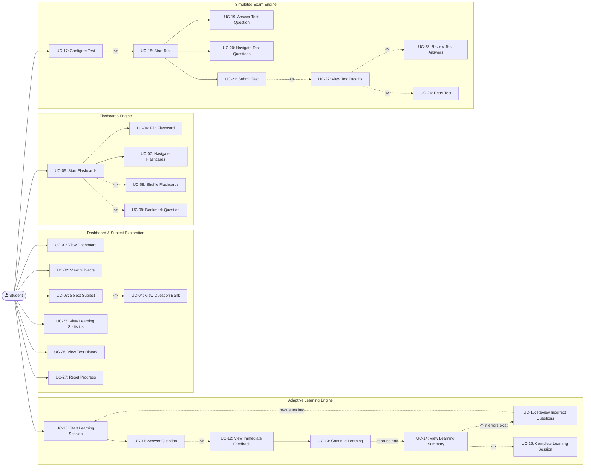

# Use Case Diagram: Recallify

This document details the architectural relationships between the primary actor (**Student**) and the system use cases, incorporating standard UML `<<include>>` and `<<extend>>` relationships.

## Relationship Explanations
1. **`UC-11 (Answer Question) <<include>> UC-12 (View Immediate Feedback)`:** Answering any question in learning mode immediately triggers feedback evaluation and display.
2. **`UC-14 (View Learning Summary) <<extend>> UC-15 (Review Incorrect Questions)`:** The repetition round is an extension available only when one or more questions were answered incorrectly in that round.
3. **`UC-21 (Submit Test) <<include>> UC-22 (View Test Results)`:** Submitting the test directly computes scores, persists historical records, and launches the results view.
4. **`UC-22 (View Test Results) <<extend>> UC-23 (Review Test Answers)` and `UC-24 (Retry Test)`:** Detailed item review and retry flow extend from the test result screen.

